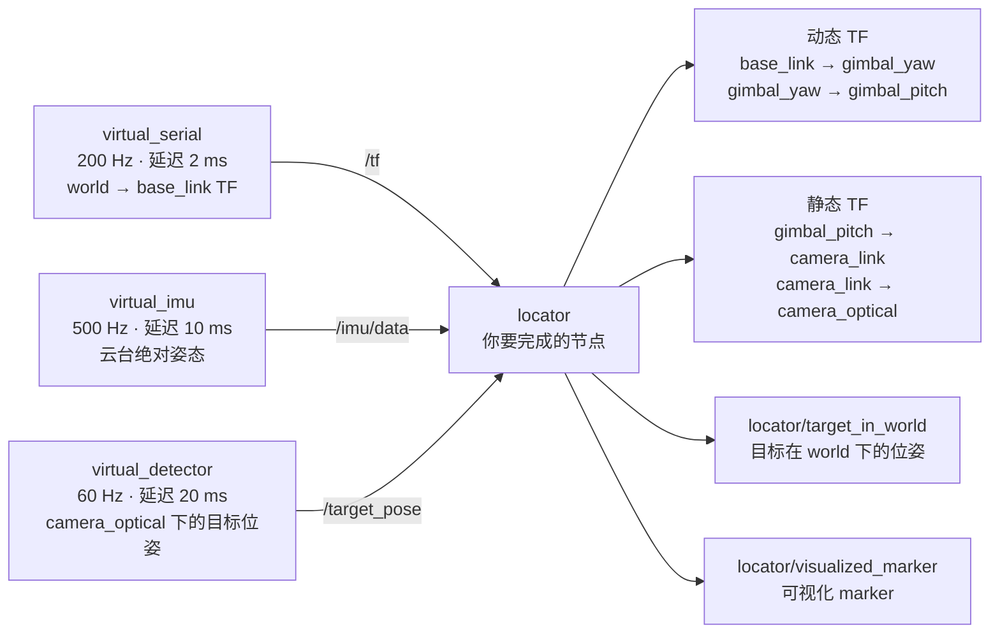

<h1 align="center">LocatorNode</h1>

## 一、任务目标

本任务的目标是：把上游给的一个观测，沿一条坐标变换链抬到世界坐标系。

一辆地面车，车顶有一个二轴云台，云台上装着相机，相机里能看到一架飞行器。上游的
detector 已经完成了识别和位姿解算，它给出的是目标**在相机光学系下**的位置。你要写的
locator 节点把这条观测沿 `camera_optical → camera_link → gimbal_pitch → gimbal_yaw →
base_link → world` 逐级变换，得到目标在世界系下的位置。

难点有两个：

- 云台的两个关节角没有人直接给你。有一个 IMU 固连在云台 pitch 连杆上，它测到的是该
  连杆**相对世界**的绝对姿态。关节角要靠这个绝对姿态、和从串口传来的底盘姿态，反解
  出来
- 三路数据（底盘、IMU、观测）各有各的频率和延迟，时间戳是各自的采样时刻。查询坐标
  变换时必须按对应的时间戳查，否则会有看不见的误差

全部使用 ROS 2 标准消息，没有自定义 interface。

上一道 `Test1_DetectorNode` 考的是把一个已有算法接成 ROS 2 节点，重点是节点、参数、
构建和 launch。本任务继续用这些，但把重点换成了坐标变换、旋转的数学、时间同步和多线程
回调，难度比上一题高。

## 二、开始之前

### 1. 环境

```bash
sudo apt install ninja-build python3-rosdep
rosdep install --from-paths src --ignore-src -y
bash check_env.sh
```

`check_env.sh` 会逐项检查并打印缺失项的修复命令。**遇到任何环境方面的问题，先跑它，
提问时把输出贴出来。**

环境和依赖的完整说明见 `docs/Something.md` 第一节到第六节。

### 2. 读文档

按这个顺序读，一共七份：

| 文档 | 内容 | 读完后做什么 |
|---|---|---|
| [Something.md](docs/Something.md) | 环境、编译、排查 | 跑通 `check_env.sh` 和仿真 |
| [Part_of_Frames.md](docs/Part_of_Frames.md) | 有哪些坐标系、为什么要电机坐标系、固连量从哪来 | 想清楚五段变换各由什么决定 |
| [Part_of_Robotics_Math.md](docs/Part_of_Robotics_Math.md) | 旋转矩阵、复合、欧拉角、姿态反解 | 完成 `tf_utils.hpp` |
| [Part_of_TF.md](docs/Part_of_TF.md) | TF 树、查询、时间戳 | 发静态 TF、写查询 |
| [Part_of_ROS2.md](docs/Part_of_ROS2.md) | QoS、回调组、组件、launch | 写订阅和 launch |
| [Part_of_Cpp.md](docs/Part_of_Cpp.md) | 智能指针、引用、lambda、异常 | 写代码时查 |
| [Part_of_Foxglove.md](docs/Part_of_Foxglove.md) | 可视化各检查点 | 验收录屏 |

`Part_of_Frames.md` 不含公式，先读它建立整体印象。`Part_of_ROS2.md` 是 Test1 那份的
续篇，节点结构、参数、launch 基础那些在 Test1 里讲过，这里不重复。

### 3. 两份配套材料

都在 `docs/assets/` 下，作为读文档时的对照：

- `frames_overview.png`：本题各坐标系的轴向示意图，已直接插在 `Part_of_Frames.md` 第一节
- `tf_coordinate_visualizer.html`：一个可拖动视角的多级坐标系演示，用浏览器打开。
  它用 three.js 自己的 y 轴朝上的坐标系，和 ROS 的 z 轴朝上不同，**看的是"多级坐标系
  怎样层层串联"这个结构**，具体轴向以文档和上面那张图为准。打开需要联网加载 three.js

### 4. 建议进度

按上一小节的顺序读文档、写代码：先环境，再坐标系和旋转数学，然后 TF、多线程与
launch，最后可视化。**同一时间下发文档和题目**，不是先读几天再发题。进度没有硬性
要求，按自己的情况调整即可。

## 三、已提供的内容

以下内容已经给出，不需要修改：

- `locator_common/`：坐标系名字的唯一来源 `frames.hpp`，和要你补的 `tf_utils.hpp`
- `locator_sim/`：四个虚拟硬件节点。**只读，不要改。** 它们同时充当校验的裁判
- `locator_common/test/test_tf_utils.cpp`：单元测试，你要让它们通过
- `locator_launcher/scripts/`：三个校验脚本
- `locator_launcher/launch/sim_only.launch.py`：只启动仿真的示例 launch，给你参照
- `locator/CMakeLists.txt`、`package.xml`：构建配置已经配好
- `locator/config/locator_params.yaml`、`locator_sim/config/sim_params.yaml`：参数已给全

## 四、数据流



如果当前 Markdown 预览器不渲染 Mermaid，可以按下面这张表理解同一条数据流：

| 上游 | 话题 | locator 使用方式 | 输出 |
|---|---|---|---|
| `virtual_serial` | `/tf` | 查询 `world → base_link` | — |
| `virtual_imu` | `/locator_sim/imu/data` | 用绝对姿态反解两个关节角 | 动态云台 TF |
| `virtual_detector` | `/locator_sim/detector/target_pose` | 把光学系观测抬到 world | `target_in_world`、marker |

TF 树（你要补四段）：

```
world（惯性系）
└── base_link（车体；仿真发布，动态，200 Hz）
    └── gimbal_yaw（你发布，动态）
        └── gimbal_pitch（你发布，动态，IMU 固连在此）
            └── camera_link（你发布，静态）
                └── camera_optical（你发布，静态）
```

## 五、需要完成的内容

### 1. `src/locator_common/include/locator_common/tf_utils.hpp`（5 个 TODO）

| 函数 | 做什么 |
|---|---|
| `try_lookup_tf` | 查询一段 TF，失败时不抛异常，返回 false |
| `make_transform` | 由平移和 RPY 欧拉角拼一个变换 |
| `to_transform_stamped` | 填一条 TransformStamped 消息 |
| `to_pose` | 把变换当成位姿转成 Pose |
| `camera_optical_rotation` | 相机机械系到光学系的固定旋转 |

每个函数上面都写了契约，注释是给定的，不要改。函数的实现要满足单元测试。

### 2. `src/locator/src/locator_node.cpp`（4 个 TODO）

| 位置 | 做什么 |
|---|---|
| 构造函数里的 TODO | 创建两个订阅，分别放进独立的回调组 |
| `publish_static_transforms` | 发布两段静态 TF |
| `imu_callback` | 由 IMU 绝对姿态反解云台关节角，发布两段动态 TF |
| `target_callback` | 把目标从光学系抬到世界系，发布 PoseStamped 和 Marker |

类的框架、参数读取、TF 的 Buffer 和广播器、可视化的 `publish_marker` 都已经给出。
每个 TODO 上面写了要求。

### 3. `src/locator_launcher/launch/locator_launcher.launch.py`（从零写）

文件不存在，需要创建。要求见 `src/locator_launcher/launch/README.md`。至少要做到：

- 四个仿真节点和 locator 放进**同一个** `ComposableNodeContainer`，用
  `component_container_mt`
- 分别加载 `sim_params.yaml` 和 `locator_params.yaml`
- 启动 `foxglove_bridge`
- 支持这些命令行参数：`use_foxglove`（默认 true）、`foxglove_port`（默认 8765）、
  `override_params`（默认 `locator_launcher/config/empty.yaml`）
- `override_params` 指向的 yaml 要叠加在**所有**节点的默认参数之后

## 六、硬约束

这几条不做到会出问题，而且有些不会报错：

1. **四个仿真节点必须在同一个进程里。** 它们靠一个进程内共享的起点对齐仿真时间。
   拆成多个进程不会报任何错，只是各节点算出的世界不一致，误差会变成几十毫米。
   这也是 locator 要放进同一个容器的原因
2. **IMU 固连在 gimbal_pitch 连杆上**，它的 `orientation` 是该连杆相对 world 的
   绝对姿态，不是关节角。关节角要靠复合求逆得到
3. **时间戳是采样时刻，不是发布时刻。** 三路数据的时间戳都比收到时刻早，早的量各不
   相同。查询 TF 要用消息自带的时间戳
4. **查询 TF 不能阻塞。** 高频回调里等待会让回调积压，最后锁死整条链路
5. **两个回调要放进独立的回调组。** 这一项运行结果不一定看得出来，批改时会看代码

## 七、验收

### 命令

```bash
# 1. 编译，零警告
rm -rf build install log
./compile.sh

# 2. 单元测试
source install/setup.bash
colcon test --packages-select locator_common
colcon test-result --verbose

# 3. 启动
ros2 launch locator_launcher locator_launcher.launch.py
```

另开两个终端，先 `source install/setup.bash`：

```bash
# 4. 云台关节角
ros2 run locator_launcher verify_gimbal.py

# 5. 世界系目标位置
ros2 run locator_launcher verify_accuracy.py

# 6. 轨迹形状（只用你自己的输出）
ros2 run locator_launcher verify_cassini.py
```

### 通过标准

- `colcon test` 全过
- 三个校验脚本都打印"通过"
- 连续运行 3 分钟以上，不崩、告警不持续增长
- Foxglove 里 TF 树完整，云台跟随，绿色轨迹与红色真值曲线重合

### 关于复测

**批改时会把 `override_params` 指向另一组安装参数，重新跑一遍上面的校验。**

这里的安装参数指相机相对云台的安装量（`mount.*` / `scene.*`）。它们由机械装配决定，
本来就可能和默认值不同。复测换的是一组不同的值，不改变任何算法要求。

这意味着：**不要把这些安装量写死，也不要在计算里忽略任何一个。** 默认参数下某些错误
写法碰巧能过，换一组参数就过不了。

## 八、提交要求

在项目根目录建一个 `result/` 目录，放两样东西。

### 1. 录屏视频（`.mp4`）

展示：

- 你的 launch 启动，五个节点和 bridge 都起来
- Foxglove 已连接，3D 面板里 TF 树完整、车在动、云台跟随、视场锥罩住目标球
- 绿色轨迹和红色真值曲线重合
- 另开终端跑 `verify_accuracy.py` 和 `verify_gimbal.py`，打印"通过"
- 连续运行几分钟不崩

不要拍屏。录屏时把 Foxglove 窗口和终端放在同一个画面里。

### 2. 一份报告

Markdown 或 PDF 都可以，包含下面三部分。

#### 反馈（三道，没有标准答案）

1. 你觉得这次培训怎么样，难度如何？和第一题相比怎么样？
2. 对后续的培训有什么建议？
3. 你学到了什么？能看出这个任务想考察什么吗？做的过程中压力如何？

觉得难、觉得文档讲得不清楚，都可以直接说。这份反馈会影响后面几周的安排。

#### 理解题（四道）

**先预测，再实际做一次验证，把你机器上跑出来的结果贴出来。** 这几道题的答案不是
背出来的，是跑出来的。改动前先把你改的代码片段贴出来，改动后贴校验脚本的输出。

1. 为什么分解出来的 roll 理论上应该恒为零？如果不为零，说明什么？

2. 把两个回调里查询 TF 的时间，从消息自带的 `header.stamp` 改成 `rclcpp::Time(0, 0,
   RCL_ROS_TIME)`（查询最新的一条）。先预测 verify_accuracy 会怎样，再实际改一次。
   报告里贴出：改动前后的平均误差、最大误差，以及 locator 的告警有没有变化。

3. 把 launch 里四个仿真节点从同一个容器改成各自独立启动（每个仿真节点都有对应的
   可执行文件，用 `ros2 pkg executables locator_sim` 可以看到）。先预测 verify_accuracy
   会怎样，再实际改一次。报告里贴出改动前后的结果，并解释为什么。

4. 你的两个订阅用的是哪种回调组？如果换成 `Reentrant`，会有什么风险？结合
   `publish_marker` 里对 `trail_points_` 的操作来说。

#### 手算题（一道，手写拍照）

不要用计算器代劳，写出推导过程，拍照放进报告。

约定：`R_{A←B}` 表示把 B 系下的向量变到 A 系下的旋转矩阵；`setRPY(roll, pitch, yaw)`
是固定轴 x-y-z 约定，`R = Rz(yaw)·Ry(pitch)·Rx(roll)`。

底盘姿态为 `roll = 90°`、`pitch = 0°`、`yaw = 90°`。IMU 测到的 pitch 连杆绝对姿态为

```
         ⎡ 1/2      0     √3/2 ⎤
R_imu =  ⎢ √3/4  -√3/2   -1/4  ⎥
         ⎣ 3/4     1/2   -√3/4 ⎦
```

(a) 写出底盘的 `R_{world←base}`。

(b) 求 `R_{base←pitch} = R_{world←base}ᵀ · R_imu`。

(c) 说明为什么这个相对旋转的 roll 分量恒为零。如果运行时分解出的 roll 明显不为零，
    说明了什么？

(d) 解出云台的两个关节角 yaw 和 pitch。

(e) 如果跳过 (b)，直接对 `R_imu` 做欧拉分解，会得到什么？为什么它不等于关节角？

## 九、发送

压缩打包时：

- 保留 `result/` 目录及其中内容
- 不要打包 `docs/`、`build/`、`install/`、`log/`
- 视频太大就先压一下，或者降低分辨率和码率
- 删除散落在各个文件夹里面的中间编译产物

提交前建议从零走一遍（`rm -rf build install log` 后重新编译），确认能跑通。

把整个 `.zip` 发到：

```text
scabbardcicada@gmail.com
```

祝顺利。

<div align="right">—— 浙江大学 RoboMaster 算法组</div>
