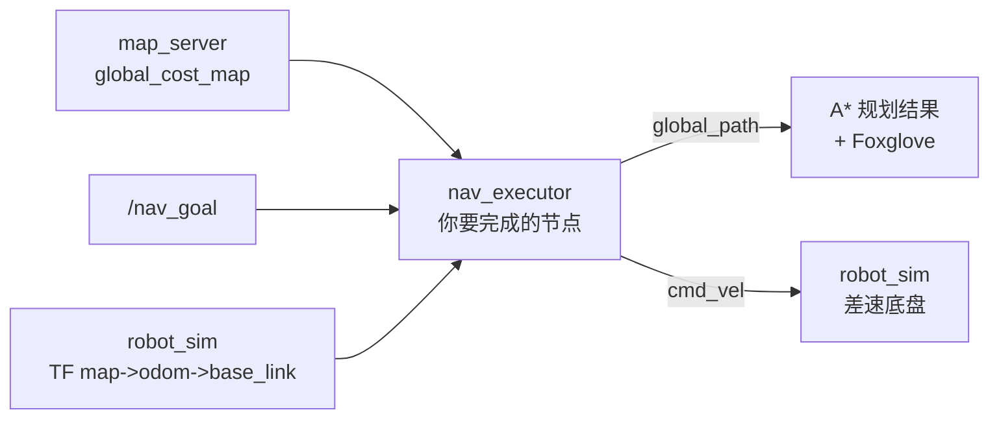

<h1 align="center">Navigation</h1>

## 一、任务目标

本任务的目标是：给定一张先验地图、一个目标点和机器人的实时定位，完成一条完整的 2D 导航链路，让差速底盘**安全地**从当前位置开到目标点。

导航是自主移动机器人的最后一环。在有地图，定位信息和决策目标的情况下，本题把它们串起来回答最后一个问题：**知道在哪、知道目标在哪之后，怎么走过去。**

本题只考"规划 + 控制"，定位和地图已经给出：

- 定位：`robot_sim` 直接发布 `map -> odom -> base_link` 的 TF，你查 TF 就能拿到 map 系位姿；
- 地图：`map_server` 发布 `/map_server/global_cost_map`。

你要完成的是：

1. **全局规划**：在栅格地图上搜出一条从当前位置到目标的合法、可执行路径；
2. **路径跟踪控制**：沿着这条路径，每个控制周期算出速度指令 `(v, ω)`；纯追踪是参考方法；
3. **导航节点**：把规划和控制串起来，订阅地图和目标、查位姿、发路径和指令；
4. **launch 文件**：一键启动整套系统。

全部使用 ROS 2 标准消息（`nav_msgs`、`geometry_msgs`），没有自定义 interface。

## 二、开始之前

### 1. 环境

```bash
sudo apt install ninja-build python3-rosdep
rosdep install --from-paths src --ignore-src -y
bash check_env.sh
```

`check_env.sh` 会逐项检查并打印缺失项的修复命令。**遇到任何环境方面的问题，先跑它，提问时把输出贴出来。**

### 2. 读文档

按 `docs/README.md` 的顺序阅读。文档按职责拆分，不要跳过坐标和 Foxglove 操作部分：

| 顺序 | 文档 | 内容 | 读完后做什么 |
|---:|---|---|---|
| 1 | `Part_of_Nav_Overview.md` | 导航四大问题、为什么分层、出题意图 | 建立整体印象 |
| 2 | `Part_of_Map.md` | map/odom/base_link、TF、栅格和代价图 | 完成 `toGridMap` 和换算 |
| 3 | `Part_of_AStar.md` | Dijkstra→A*、启发、对角穿墙 | 完成 `astar_planner.cpp` |
| 4 | `Part_of_PathTracking.md` | 差速运动学、纯追踪 | 完成 `pure_pursuit.cpp` |
| 5 | `Part_of_NavExecutor.md` | 导航节点、路径和 launch | 完成节点集成 |
| 6 | `Part_of_Foxglove.md` | 在 3D 面板中点击发布目标点 | 向导航系统发送目标点 |

坐标、代价图和节点文档先建立整体印象；A\* 和纯追踪文档再分别推导算法公式。

## 三、已提供的内容

以下内容已经给出，不需要修改：

- `nav_common/`：数据结构（`GridMap`、`Vec2d`、`Pose2d`）和坐标系名字（`frames.hpp`）
- `nav_sim/`：差速底盘仿真 + 真值旁路。
- `map_server/`：地图加载 + 代价图生成（读 terrain msgpack、连续梯度膨胀、发 `/map_server/global_cost_map`）。
- `nav_planner/test/`、`nav_controller/test/`：单元测试，你要让它们通过
- `nav_launcher/scripts/`：三个校验脚本
- `nav_sim/launch/sim_only.launch.py`：只启动仿真（含地图服务器）的示例 launch，给你参照
- 各包的 `CMakeLists.txt`、`package.xml`、`config/*.yaml`：构建和参数已配好

## 四、数据流



| 上游 | 话题/TF | nav_executor 使用方式 | 输出 |
|---|---|---|---|
| `map_server` | `/map_server/global_cost_map`（OccupancyGrid） | 转成 `GridMap`，作为规划输入 | — |
| verify 脚本 / Foxglove | `/nav_goal`（PointStamped） | 触发规划 | — |
| `robot_sim` | TF `map -> base_link` | 查当前位姿 | — |
| — | — | A\* 规划 | `/nav_executor/global_path`（Path） |
| — | — | 纯追踪 | `/nav_executor/cmd_vel`（Twist） |
| `robot_sim` | 真值位姿历史 | Foxglove 显示实际轨迹 | `/nav_sim/ground_truth_path`（Path） |
| `robot_sim` | `/nav_sim/map_velocity`（TwistStamped，frame=map） | Foxglove 观察实际地图系速度 | `linear.x/y` |

## 五、需要完成的内容

### 1. `src/nav_planner/src/astar_planner.cpp`

实现三个函数：`gridToWorld`、`worldToGrid`、`planPath`。函数签名和契约在
`include/nav_planner/astar_planner.hpp`。实现要满足单元测试。

`planPath` 是核心：在世界坐标上做全局搜索，返回合法、可执行路径。可以使用 A\*、Dijkstra、
带安全代价的搜索或其他合理方法。要点：

- 8 邻域展开，直方向代价 `resolution`、对角代价 `resolution × √2`；
- 如果使用 A\*，启发函数应与移动模型匹配；8 邻域时不要使用会高估的曼哈顿距离；
- 对角移动要禁止"穿墙角"（两个相邻直方向格子必须都是自由格）；
- 障碍判定用 `occupied_threshold`，比较的是"大于等于"，不是"等于 100"。

### 2. `src/nav_controller/src/pure_pursuit.cpp`

实现 `computeCommand`。签名和契约在 `include/nav_controller/pure_pursuit.hpp`。

路径跟踪控制器需要找出跟踪目标并输出有限的差速指令。参考实现使用纯追踪：把前瞻点变换到
车体系并计算曲率，再将角速度夹到 `[-max_angular_velocity, max_angular_velocity]`；也可以
使用 Stanley 等其他方法。线速度在接近目标时逐渐降低，执行器还会限制相邻周期的加速和减速。
到达判定是"到路径最后一点的距离 < goal_tolerance"。

### 3. `src/nav_executor/src/nav_executor_node.cpp`

实现五个 TODO：`toGridMap`（消息转结构体）、`lookupPose`（查 TF 拿 map 系位姿）、
`plan`（规划）、`goalCallback`（存目标 + 触发规划）、`tick`（控制循环）。

类的框架、订阅发布、TF、定时器、`publishPath`、`publishZeroCmdVel` 都已给全，你只填
导航逻辑。注意：**位姿要查 TF（`map -> base_link`）得到，不能直接拿 `odom` 系的里程计
位姿当 map 系用。**

### 4. `src/nav_launcher/launch/nav.launch.py`

文件不存在，需要创建。要求见 `src/nav_launcher/launch/README.md`。至少要做到：

- 使用 `component_container_mt` 加载 `map_server`、`robot_sim`、`nav_executor` 三个组件及各自参数文件
- 独立启动 `foxglove_bridge`，默认端口 `8765`；提供开关和端口 launch 参数

## 六、硬约束

这几条不做到会出问题，而且有些不会报错：

1. **位姿必须查 TF 得到。** `map -> odom` 不是恒等变换（默认偏移约 1 米）。把 odom 系
   位姿当 map 系用，路径和控制会整体偏移
2. **规划使用代价图。** `/map_server/global_cost_map` 中 `100` 是真实障碍，`99` 是 inscribed，
   `1..98` 是连续梯度区，`99` 是内切区，`0` 是自由。规划默认避开 `>= 99`，碰撞判定只看 `>= 100`。
   这两者不要混。
3. **路径、目标、地图都在 map 系。** 规划起点和纯追踪位姿也要是 map 系，否则三样东西
   不在同一套坐标里
4. **路径必须合法且可执行。** 不得经过障碍、穿墙角或产生无法连接的路径段；可以为了安全距离牺牲几何最短性。

## 七、验收

### 命令

```bash
# 1. 编译，零警告
rm -rf build install log
./compile.sh

# 2. 单元测试
source install/setup.bash
colcon test --packages-select nav_planner nav_controller
colcon test-result --verbose

# 3. 启动
ros2 launch nav_launcher nav.launch.py
```

另开终端，先 `source install/setup.bash`。三个运行时校验分别从新启动的导航系统运行：启动整套系统后运行一个脚本；脚本退出后停止系统、重新启动，再运行下一个。这样每项测试都从仿真起点开始。

```bash
# 4. 规划器
ros2 run nav_launcher verify_planner.py

# 5. 闭环到达
ros2 run nav_launcher verify_reach.py

# 6. 跟踪质量
ros2 run nav_launcher verify_tracking.py
```

### 关于复测

**批改时会换一个目标点，重新跑三个校验脚本。** 目标点参数（`goal_x`、`goal_y`）是
校验脚本的参数，本来就可能不同。这意味着：**不要在任何地方写死目标、路径或地图尺寸，**
默认目标下某些错误写法碰巧能过，换个目标就过不了。

## 八、提交要求

完成所有部分后，在项目根目录建一个 `result/` 目录，里面放两样东西：

**1. 录屏视频（`.mp4`）**

需要展示：

- 你的节点正在运行
- Foxglove 已连接，3D 面板里能看到地图
- 发一个目标点后，车沿着路径走到目标，没有很明显的卡墙问题

**2. 一份报告**

格式上Markdown，PDF都可以。回答下面三个问题：

1. 你学到了什么？是否能看出这个任务想考察什么？做的过程中压力如何？
2. 你做了哪些尝试？哪些方法行得通，哪些不行？为什么？
3. 你有使用AI辅助吗，如果有，你是如何使用的？

回答三个问题即可，没有标准答案，写真实想法。

如果有没做完的部分，也在报告里写清楚卡在哪里、尝试过什么。

### 发送

压缩打包时注意：

- 整体不超过 20 MB
- 保留 `result/` 目录及其中的录屏和报告
- 不要打包 `docs/`
- 不要打包 `build/`、`install/`、`log/` 等编译产物
- 视频太大就先压一下，或者降低录屏分辨率和码率

提交前建议自己从零走一遍（`rm -rf build install log` 后重新编译），确认能跑通。

把整个.zip发到：

```text
2759879494@qq.com
```
祝顺利 😊😊😊

<div align="right">—— 浙江大学 RoboMaster 算法组</div>
