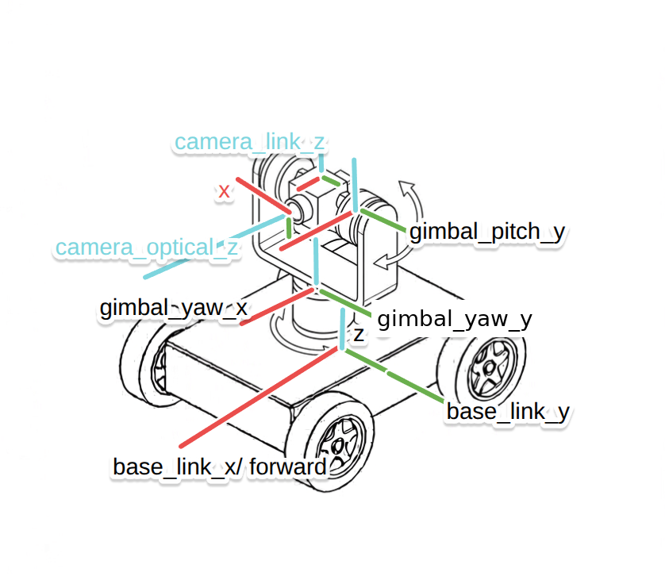

# Test2 LocatorNode 教学文档

本周任务是一个 ROS 2 定位节点。一辆地面车，车顶装着二轴云台和相机，相机跟踪一架飞行器。
上游的 detector 已经解出目标在**相机光学系**下的位姿；你要写的 locator 把它沿

```
camera_optical → camera_link → gimbal_pitch → gimbal_yaw → base_link → world
```

逐级变换回世界系。云台那两个关节角没有人直接给你——它们要从一个装在云台上的 IMU 测到的
绝对姿态反解出来。中间涉及的坐标变换、旋转数学、时间同步和多线程回调，就是本周要学的。



> **先读 `QUESTION.md`。**
>
> 任务范围、要你完成的文件、验收标准，都在那里。本文件只是下面这些文档的索引。

> **有问题及时来线下基地问，不要一直拖着。**
>
> 环境装不上、报错看不懂、卡住了，都带上完整报错和 `check_env.sh` 的输出，过来当面说。

## 文档说明

共七份，都是学习材料，不是题面。

| 文档 | 内容 |
|---|---|
| [Something.md](docs/Something.md) | 环境。装依赖、跑自检、编译、按报错排查、残留进程，以及几个工程约定 |
| [Part_of_Frames.md](docs/Part_of_Frames.md) | 这台车有哪些坐标系、为什么要有电机坐标系、机械图纸上的尺寸怎样变成坐标变换。不含公式 |
| [Part_of_Robotics_Math.md](docs/Part_of_Robotics_Math.md) | 机器人学数学。旋转矩阵、坐标变换的复合与求逆、欧拉角与四元数、从 IMU 绝对姿态反解关节角 |
| [Part_of_TF.md](docs/Part_of_TF.md) | TF 系统。坐标系树、变换的发布与查询、静态与动态、按哪个时间查、REP-103 与相机光学系 |
| [Part_of_ROS2.md](docs/Part_of_ROS2.md) | ROS 2 进阶。QoS、执行器与回调组、组件与容器、launch。是 Test1 那份的续篇 |
| [Part_of_Cpp.md](docs/Part_of_Cpp.md) | 本题用到的 C++。智能指针、引用、lambda、异常、std::function，每种对应代码里的具体一行 |
| [Part_of_Foxglove.md](docs/Part_of_Foxglove.md) | 可视化。3D 面板、Transform Tree、Plot，以及各检查点应该看到什么 |

配套材料在 `docs/assets/`：上面这张坐标系示意图、一张启动仿真后 Foxglove 的效果图（插在
`Part_of_Foxglove.md` 里）、一个可交互的多级坐标系演示网页 `tf_coordinate_visualizer.html`。

## 环境

文档以 **Ubuntu 24.04 + ROS 2 Jazzy** 为主线，在 **Ubuntu 26.04 + ROS 2 Lyrical** 上
验证过。两个发行版上代码都不用改，已知的差异见 `docs/Something.md` 第三节。

**拿到仓库后第一件事，先跑环境自检**（`check_env.sh`，在仓库根目录）：

```bash
bash check_env.sh
```

它会逐项检查系统版本、ROS 2 发行版、编译工具、需要的包、依赖是否装齐、端口和残留进程，
缺什么直接给出安装命令。它只检查、不改你的系统。遇到环境问题，把它的输出贴出来提问。

命令里的 ROS 路径统一用 `$ROS_DISTRO`，不需要按发行版手改。文档里的命令都**不写**
`source /opt/ros/$ROS_DISTRO/setup.bash`，这句一般已经在 `~/.bashrc` 里。新终端里
`echo $ROS_DISTRO` 有输出就说明已经生效，此时每个新终端只需要：

```bash
source install/setup.bash
```
