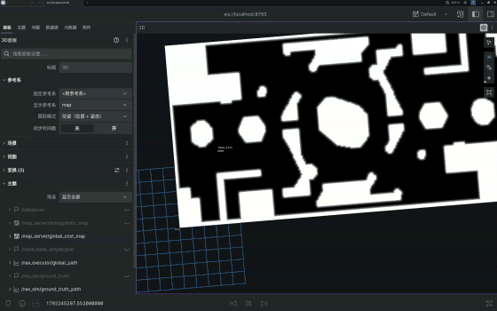

# Test4 Navigation 教学文档

本周任务是导航：占据栅格全局规划 + 差速底盘路径跟踪，把机器人安全开到目标点。A\* 和纯追踪是参考实现，也可以根据需求选择合适的算法。

- 地图：`map_server` 直接读取比赛地形标注 `.msgpack`，只保留真实障碍并生成**连续梯度代价图**，发到 `/map_server/global_cost_map`。

目标话题类型约定：Foxglove 点击发布 `/nav_goal` 使用 `geometry_msgs/msg/PointStamped`；`PoseStamped` 仅用于机器人真值和 `nav_msgs/Path` 的路径点，不要将两者混用。
- 定位：`robot_sim` 发布 `map -> odom -> base_link` 的 TF，查 TF 即可得 map 系位姿。
- 速度观察：`robot_sim` 发布 `/nav_sim/map_velocity`（`TwistStamped`），表示 map 坐标系下的实际 `x/y` 速度。
- 你要写：全局规划器、路径跟踪控制器、导航节点和 launch 文件；A\* 与纯追踪作为参考方法。

题目和提交要求见 [`QUESTION.md`](QUESTION.md)。开始之前先读 `docs/` 下的材料，顺序见 `QUESTION.md`。

## 目录结构

```text
Test4_Navigation/
├── QUESTION.md                     题面：任务、要改的文件、编译运行、提交要求
├── README.md                       本文件
├── check_env.sh                    环境自检，缺依赖会打印修复命令
├── compile.sh                      Ninja 编译脚本
├── docs/                           教学文档，阅读顺序见 docs/README.md
│   ├── README.md                   文档目录和学习路线
│   ├── Part_of_Nav_Overview.md     导航四大问题、分层、出题意图
│   ├── Part_of_Map.md              坐标系、TF、栅格换算和代价图
│   ├── Part_of_AStar.md            A*、启发函数、对角穿墙
│   ├── Part_of_PathTracking.md     差速运动学、纯追踪
│   ├── Part_of_NavExecutor.md      节点集成和 launch
│   └── Part_of_Foxglove.md         在 3D 面板中点击发布目标点
└── src/
    ├── nav_common/                 数据结构 + 坐标系名字（只读）
    ├── nav_sim/                    差速底盘仿真 + 真值（只读，裁判）
    ├── map_server/                 地图加载 + 代价图（只读）
    │   ├── maps/                   RMUC202605.msgpack（比赛地图资源）
    │   └── scripts/convert_map.py  msgpack → PGM/YAML 离线查看工具
    ├── nav_planner/                A* 规划器（要改）
    ├── nav_controller/             纯追踪控制器（要改）
    ├── nav_executor/               导航节点（要改）
    └── nav_launcher/               launch + 校验脚本（要改 launch）
```

顶层 `build/`、`install/`、`log/` 是编译产物，已被 `.gitignore` 忽略，不用管。

## 快速开始

```bash
# 1. 环境自检（缺什么会打印修复命令）
bash check_env.sh

# 2. 编译
./compile.sh
source install/setup.bash

# 3. 只跑仿真（看地图、TF、里程计是否正常；含 Foxglove bridge）
ros2 launch nav_sim sim_only.launch.py

# 4. 完成作业后，一键启动整套系统
ros2 launch nav_launcher nav.launch.py
```

启动后 Foxglove bridge 自动监听 `ws://localhost:8765`。浏览器打开
<https://app.foxglove.dev>，连接 Foxglove WebSocket，把 3D 面板的显示帧设为 `map`，
加 `/map_server/global_cost_map`、`/nav_executor/global_path`、`/nav_sim/ground_truth_path`。
需要观察速度时，在 Plot 面板添加 `/nav_sim/map_velocity.twist.linear.x` 和
`/nav_sim/map_velocity.twist.linear.y`；该话题的 `frame_id` 是 `map`。
其中 `global_path` 是计划路线，`ground_truth_path` 是实际走过的路线；
`/nav_sim/ground_truth` 则只是当前时刻的单个位姿，主要供校验脚本使用。

## 测试

单元测试（完成对应算法文件后应全部通过）：

```bash
source install/setup.bash
colcon test --packages-select nav_planner nav_controller
colcon test-result --verbose
```

运行时检查（整套 launch 跑起来后另开终端）：

三个脚本分别从新启动的导航系统运行。每次只运行一个脚本；脚本退出后停止整套系统，重新启动，再运行下一个。这样每项测试都从仿真起点开始，不会沿用上一个脚本留下的机器人位置。

```bash
ros2 run nav_launcher verify_planner.py
ros2 run nav_launcher verify_reach.py
ros2 run nav_launcher verify_tracking.py
```

## 新人学习路线

不要一上来就改四个 TODO。按下面的顺序做，每一步都有独立的判断标准：

1. **先确认环境**：运行 `bash check_env.sh`。出现缺失项时先解决环境问题，不要把依赖错误当成代码错误。
2. **只看仿真**：运行 `ros2 launch nav_sim sim_only.launch.py`。确认地图、`map -> odom -> base_link`、`/nav_sim/ground_truth` 和 `/nav_sim/ground_truth_path` 正常；此时车不会移动，也不会有计划路径（实际轨迹只有起点）。
3. **理解地图**：阅读 `Part_of_Map.md`，手算一个世界坐标到栅格坐标的例子，确认 `col ↔ x`、`row ↔ y`。
4. **完成 A\***：先实现 `gridToWorld`、`worldToGrid`，再实现 `planPath`。每完成一个小步骤就运行 `colcon test --packages-select nav_planner`。
5. **完成纯追踪**：阅读公式后实现 `computeCommand`，运行 `colcon test --packages-select nav_controller`。
6. **完成节点集成**：实现 `nav_executor_node.cpp` 的五个 TODO，重点检查 TF 查询使用的是 `map -> base_link`。
7. **完成 launch**：按 `src/nav_launcher/launch/README.md` 创建 `nav.launch.py`，然后启动整套系统。
8. **分层验收**：分别从新启动的系统运行 `verify_planner.py`、`verify_reach.py` 和 `verify_tracking.py`，每个脚本运行后重启系统再测下一项。路径错查 A\*，路径对但车不到查 TF/节点逻辑，车能到但偏差大查纯追踪。

## 预期结果

由于大家第一次接触导航，只需要跟着文档走，大致实现如下效果即可：



动图为压缩版，完整视频见 [`nav.mp4`](nav.mp4)。

---

祝顺利 😊😊😊

<div align="right">—— 浙江大学 RoboMaster 算法组</div>
