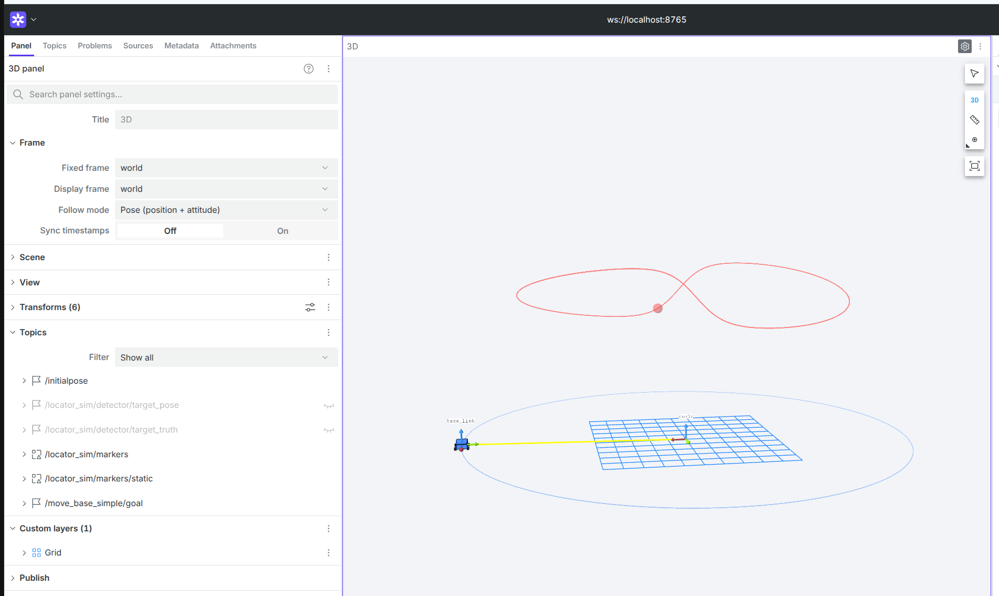

<h1 align="center">Part of Foxglove</h1>

这份文档讲怎样用 Foxglove 检查本题的每一步，以及验收录屏要拍什么。

Test1 的 `Part_of_Rviz_Foxglove.md` 讲过 bridge 是什么、怎样启动、网页版怎样连接，这里不重复。本文讲本题用到的四个面板（3D、Transform Tree、Plot、Raw Messages），以及每个检查点在面板里应该看到什么。

文中的面板名称和设置项依据 Foxglove 官方文档（2026 年 10 月）。Foxglove 的界面更新较快，名称对不上时按功能找。本题用到的 `foxglove_bridge` 在 Jazzy 和 Lyrical 上都是 3.5.0 版。

全部完成后，在 Foxglove 里看到的效果大致如下：



## 一、连接

`sim_only.launch.py` 和你要写的 `locator_launcher.launch.py` 都会顺带启动 bridge，不需要单独开。

```bash
source install/setup.bash
ros2 launch locator_launcher sim_only.launch.py
```
这个命令只启动仿真侧，用来看仿真背景和 TF 树的起点。

浏览器打开 [Foxglove Web](https://app.foxglove.dev/)，新建连接，选 **Foxglove WebSocket**，地址填 `ws://localhost:8765`。

**两个 launch 不要同时开。** 两者都会起一套仿真、一个 bridge：bridge 抢同一个端口，两套仿真往 `/tf` 上发两份互相矛盾的底盘位姿，Foxglove 里车会来回跳。切换前先 `Ctrl+C` 停掉上一个，再用 `pgrep -af component_container` 确认没有残留。

连不上时按顺序查：

```bash
ros2 pkg prefix foxglove_bridge     # 装了吗
ros2 node list                      # bridge 起来了吗
ss -ltn | grep 8765                 # 端口在监听吗
```

bridge 默认监听 `0.0.0.0` 且没有鉴权，同一局域网的其他设备也能连上。共享网络里调试完记得关掉。

## 二、3D 面板

本题主要靠 3D 面板。

### 坐标系设置

面板设置的 **Frame** 分组里有两个关键项：

- **Fixed frame**：场景的固定参考系。物体按它来摆放，跨时间累积的东西也存在它下面
- **Display frame**：视角跟随的坐标系

两项都**手动选 `world`**，Follow mode 选 **Off**。这样卵形线固定在屏幕上，车绕着它走。

Fixed frame 的默认值是 `<Root frame>`，即 TF 树的根。本题写到一半时，TF 可能是两棵互不相连的树（见第五节「发出静态 TF 之后」），这时根是哪个说不准，所以不要用默认值。

想跟着车看时，Display frame 改成 `base_link`，Follow mode 改成 **Position**。

### 显示 TF

面板设置的 **Transforms** 分组：

- **Labels** 打开，每个坐标系旁边标出名字
- **Axis scale** 调大一些，默认的轴在这个场景尺度下很短

场景里能看到每个坐标系的三根轴，配色是 ROS 惯例：x 红、y 绿、z 蓝。各轴应该指向哪里，对照 `docs/assets/frames_overview.png`。

展开 Transforms 分组，点某个坐标系，可以看到它相对父坐标系的平移和旋转数值（**Values relative to** 选 **Parent**）。检查静态 TF 时，这里的数值和 `tf2_echo` 的输出是同一回事。

### 话题

| 话题 | 类型 | 在 3D 面板里显示为 |
|---|---|---|
| `/tf`、`/tf_static` | `tf2_msgs/msg/TFMessage` | 坐标系的轴 |
| `/locator_sim/markers/static` | `MarkerArray` | 车体、轮子、云台、相机、视场锥、红色真值卵形线、蓝色底盘行驶圆 |
| `/locator_sim/markers` | `MarkerArray` | 半透明红色的目标真值球 |
| `/locator_sim/detector/target_pose` | `PoseStamped` | detector 的原始观测，在 `camera_optical` 下 |
| `/locator_sim/detector/target_truth` | `PoseStamped` | 目标真值，在 `world` 下 |
| `/locator/target_in_world` | `PoseStamped` | 你算出的目标位姿 |
| `/locator/visualized_marker` | `Marker` | 你算出的目标：绿色球和绿色累积轨迹 |

在 Topics 列表里逐个打开（有的话题要等你写完 locator 的代码才会出现）。`PoseStamped` 默认画成一个箭头。

### 物体按它自己的时间戳摆放

Foxglove 官方文档对 3D 面板有一条规定：一个物体要显示出来，必须存在一条从它的坐标系到 Display frame 的变换路径，而且这条路径要在**该消息的时间戳那一刻（或之前）** 就存在。用的是消息里的 `header.stamp`，不是 Foxglove 收到消息的时间。原文见 [3D panel](https://docs.foxglove.dev/docs/visualization/panels/3d) 的 Visualization 一节。

这和 tf2 按时间戳查询是同一个道理（见 `Part_of_TF.md` 第四节）。两个推论：

- 输出消息的时间戳填错，物体会显示在错误的位置，或者根本不显示
- 一个 `camera_optical` 下的消息能不能显示，取决于你发布的整条 TF 链在它的时间戳那一刻是否连通。第五节的一个检查点就利用了这一点

### 两种 marker

仿真发的车体、云台、相机、视场锥，`frame_id` 是 `base_link`、`gimbal_yaw` 这类会动的坐标系，并设了 `frame_locked = true`。frame_locked 的意思是让 marker 一直跟着自己的坐标系走，坐标系动，它就动。这些 marker 只发布了一次，车却能一直在场景里绕圈，靠的就是这个设置。

真值卵形线挂在 `world` 下，`world` 不动，所以它不需要 frame_locked。

这些静态 marker 用 `transient_local` 的 QoS 只发一次。bridge 发现某个话题的发布者全是 transient_local 时，自己也用 transient_local 订阅，因此能拿到发布者保留的那一条；它还会把消息缓存下来，回放给之后连上的其他客户端。所以先启动仿真、后打开 Foxglove，车体一般也能看到。万一没看到，重启一次仿真即可。

## 三、Transform Tree 面板

加一个 **Transform Tree** 面板。它把坐标系按父子关系列成树，点某个坐标系，能看到它最近一次收到变换的时间和累计条数。

它和命令行的 `ros2 run tf2_tools view_frames` 看的是同一件事，只是实时刷新。树从中间断开、某一段停止更新、父子方向写反，在这里都能看出来。

## 四、Plot 与 Raw Messages

### 按时间画曲线

加一个 **Plot** 面板，加两个系列：

```
/locator/target_in_world.pose.position.x
/locator_sim/detector/target_truth.pose.position.x
```

每个系列的 **Timestamp** 设置改成 **Header stamp**。默认是 Log time，即 Foxglove 收到消息的时间；改成 Header stamp 后，横轴是消息自带的时间戳，两条曲线按同一时刻对齐。本题的校验脚本也是按这个时间戳配对的。

两条曲线应该重合。y、z 同理。

### 画出两条卵形线

再加一个 Plot 面板，**X-axis value type** 改成 **Expression**，画 XY 图：

| 系列 | X | Y |
|---|---|---|
| 真值 | `/locator_sim/detector/target_truth.pose.position.x` | `/locator_sim/detector/target_truth.pose.position.y` |
| 你的输出 | `/locator/target_in_world.pose.position.x` | `/locator/target_in_world.pose.position.y` |

**Axis scales** 设成 **1:1**，**Time range** 设成 **All**。运行一圈（约 18 秒）后，两条花生形的卡西尼卵形线应该叠在一起。

### 看一条消息的全部字段

加一个 **Raw Messages** 面板，选 `/locator/target_in_world`，可以看到最新一条消息的全部字段。检查 `header.frame_id` 是不是 `world`、`header.stamp` 是不是一个合理的时间。命令行的等价写法是 `ros2 topic echo /locator/target_in_world --once`。

## 五、各检查点应该看到什么

每完成一步，就顺手连上来看一眼。卡住的时候，先回头确认前面几步在 Foxglove 里是不是对的。

### 启动仿真之后

```bash
ros2 launch locator_launcher sim_only.launch.py
```

- Transform Tree 里只有 `world → base_link`
- 车体和四个轮子沿蓝色的圆绕行，车身有轻微颠簸
- 红色卵形线上有一个半透明红球在飞

**云台、相机和视场锥看不到**。它们挂在 `gimbal_yaw` 及以下的坐标系上，这些坐标系现在还没有人发布，3D 面板找不到通往 `world` 的路径。后面的任务就是补上这几段。

### 发出静态 TF 之后

先用临时的 launch 把仿真和 locator 一起启动（先跑起来就行，细节以后再补）。

- 3D 面板里**仍然看不到**相机和视场锥。`gimbal_pitch` 的父坐标系要等 `imu_callback` 来发布，这两段静态 TF 暂时连不到 `world`
- Transform Tree 里出现了**第二棵独立的树**：`gimbal_pitch → camera_link → camera_optical`

能看到这棵小树，就说明静态 TF 发出来了，父子方向也是对的。数值用命令行检查：

```bash
ros2 run tf2_ros tf2_echo gimbal_pitch camera_optical
```

### 完成 imu_callback 之后

- Transform Tree 连成一整棵：`world → base_link → gimbal_yaw → gimbal_pitch → camera_link → camera_optical`
- 车顶出现云台和相机，黄色视场锥跟着云台转，**始终罩住红球**

视场锥罩住目标，只能说明关节角大致对。更严格的检查是：在 Topics 里打开 `/locator_sim/detector/target_pose`。

这条消息是 detector 的原始观测，表达在 `camera_optical` 下。Foxglove 会按它的时间戳，沿**你发布的**整条 TF 链把它变换到 `world` 再画出来。这一步一行 target_callback 都不需要写。

- 箭头稳定地落在红球上：TF 链是对的。红球画的是当前时刻的真值，观测是 20 ms 前曝光的，两者会差几厘米，相对红球的大小可以忽略
- 箭头偏离红球、或者随车颠簸来回晃：链上某一段有问题

数值上的检查用 `verify_gimbal.py`。

### 完成 target_callback 之后

- 出现绿色的球和一条不断延长的绿色轨迹
- 绿球和红球重合，绿色轨迹和红色卵形线重合
- 打开 `/locator/target_in_world`，箭头和上一步的 `target_pose` 箭头重合
- 第四节的两个 Plot 里，曲线都重合

### 全部完成

完整的 launch 起来之后，以上现象全部出现。用 `verify_accuracy.py` 和 `verify_cassini.py` 做数值确认。

## 六、录屏

要拍的内容见 `QUESTION.md` 第八节。几点建议：

- 用系统自带的录屏或 OBS，不要拍屏
- Foxglove 窗口和终端放在同一个画面里，能看出是同时在运行
- 3D 面板的视角调到能同时看到车、云台和整条卵形线
- 绿色轨迹会累积，录之前先让它跑满一圈（约 18 秒）

## 七、排查

| 现象 | 先查什么 |
|---|---|
| 连不上 `ws://localhost:8765` | 第一节的三条命令 |
| 车在场景里来回跳 | 两个 launch 同时在跑，或者有残留进程（第一节） |
| 什么都不显示 | Fixed frame 是否手动选了 `world`（第二节） |
| 话题打开了但不显示，旁边有警告图标 | 展开看提示。多半是缺少某两个坐标系之间的变换，对照 Transform Tree 找断在哪一段 |
| 看不到云台和视场锥 | Transform Tree 里 `base_link → gimbal_yaw` 这一段出现了吗；`ros2 topic hz /tf` 约 700 Hz 吗 |
| 视场锥不罩住目标 | 关节角反解错了，跑 `verify_gimbal.py` |
| `target_pose` 的箭头偏离红球 | TF 链有一段不对。关节角对不对看 `verify_gimbal.py`，静态 TF 用 `tf2_echo` 看 |
| 看不到绿色球 | `ros2 topic hz /locator/target_in_world` 有输出吗；有输出就检查 `header.frame_id` 和 `header.stamp`（第四节 Raw Messages） |
| 绿色轨迹偏离红色卵形线 | `Part_of_TF.md` 第九节 |

---

<div align="right">—— 浙江大学 RoboMaster 算法组</div>
