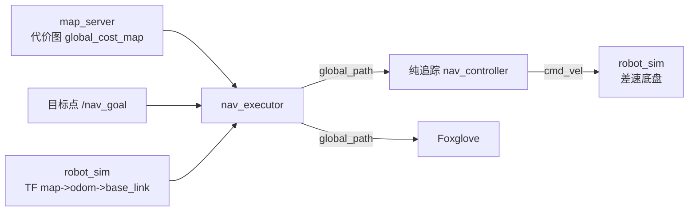

<h1 align="center">Part of Navigation Overview</h1>

这份文档是整套材料的总纲，建议先读。它回答三个问题：导航系统到底在做什么、本题为什么只挖那几个地方、以及"规划"和"控制"为什么要分成两层。不涉及算法细节，那些交给后面的专项文档。

读完之后，你对整个工程应该有一张完整的地图：知道每个包在干什么、数据从哪流到哪、哪些代码是给你的、哪些要你自己写。

## 一、导航系统在做什么

一个能自主移动的机器人，本质上在做一件事，就是循环回答四个问题：

1. **我在哪？**（定位）
2. **周围有什么？**（地图）
3. **怎么走到目标？**（规划）
4. **怎么走得稳、走得安全？**（控制）

这四个问题对应一条数据流：

```
传感器(雷达/IMU) → 定位 → 地图 → 规划 → 控制 → 底盘指令
```

任何一个能自主移动的机器人，从扫地机器人到 RoboMaster 哨兵，都在这条链上。理解这条链，你就理解了所有导航系统的骨架。

先划清一条边界：**目标点不是导航系统自己想出来的。**"去哪、为什么去"是战术问题，由一个独立的决策模块回答（本题里就是 `verify` 脚本或你在 Foxglove 里点一下，发一个 `/nav_goal`）。导航只负责两件事：把车安全地送到那个点，以及在这个过程中保护车自己。

## 二、本题的边界：只考"规划 + 控制"

这条链很长，本题不让你从头搭。前面四个问题里，有两个已经给你解决了：

| 导航子问题 | 本题怎么处理 | 为什么 |
|---|---|---|
| 定位（我在哪） | **已给**。`robot_sim` 直接发布 `map -> odom -> base_link` 的 TF，你查 TF 就能拿到 map 系位姿 | 坐标变换在 Test2 已经练过 |
| 地图（周围有什么） | **已给**。`map_server` 读地图文件、生成代价图（占据栅格 + inflation） | 建图大家有兴趣再去了解 |
| 规划（怎么走） | **你要写** | A\* 全局规划 |
| 控制（怎么走稳） | **你要写** | 路径跟踪控制 |

所以本题的完整闭环是：

```
/map_server/global_cost_map（代价图）─┐
/nav_goal（目标点）───────────────────┤→ A* 规划 → global_path → 纯追踪 → cmd_vel → 底盘
TF map->base_link（定位）─────────────┘
```

**给定地图 + 定位 + 目标点，用 A\* 规划 + 纯追踪控制，把差速底盘安全送到。**

## 三、为什么要分"规划"和"控制"两层

新手最容易犯的错，是想一步到位：从当前位置直接算出该发什么速度。这在简单场景可能行，一旦有障碍就崩了。

工程上分而治之，是导航最基本的思考方式：

- **规划（全局）**：在整张地图上回答"走哪条路"。它看得远（整张地图）、反应慢（目标不变就不重算）、输出的是**几何路径**（一串坐标点），不关心车怎么开。
- **控制（局部）**：拿到路径后回答"现在该发什么速度"。它看得近（只关心车周围）、反应快（每个周期都算）、输出的是**速度指令** `(v, ω)`。

为什么必须分两层？举一个反例就懂了：假设你只写一个控制器，让车朝目标点直走，一遇到障碍就卡死。因为"从哪边绕过去"是一个**全局**问题，需要看整张地图才能回答；而"现在这一拍发什么速度"是一个**局部**问题。


## 四、数据流



| 谁发的 | 话题/TF | 谁消费 | 用途 |
|---|---|---|---|
| `map_server` | `/map_server/global_cost_map`（OccupancyGrid） | `nav_executor` | 规划的输入 |
| verify 脚本 / Foxglove | `/nav_goal`（PointStamped） | `nav_executor` | 目标点 |
| `robot_sim` | TF `map->odom->base_link` | `nav_executor` | 当前位姿 |
| `nav_executor` | `/nav_executor/global_path`（Path） | 纯追踪 + Foxglove | 规划的几何路径 |
| `nav_executor` | `/nav_executor/cmd_vel`（Twist） | `robot_sim` | 速度指令，驱动机器人 |
| `robot_sim` | `/nav_sim/ground_truth`（PoseStamped） | verify 脚本 | 真值旁路，裁判用 |
| `robot_sim` | `/nav_sim/ground_truth_path`（Path） | Foxglove | 累积的实际行驶轨迹 |
| `robot_sim` | `/nav_sim/map_velocity`（TwistStamped，frame=map） | Foxglove | 地图坐标系下的实际 x/y 速度 |

## 五、任务需求

```text
src/
├── nav_common/      数据结构 + 坐标系名字（只读）
├── nav_sim/         差速底盘仿真 + 真值（只读，同时是裁判）
├── map_server/      地图加载 + 代价图（只读）
├── nav_planner/     【写】astar_planner.cpp —— A* 全局规划
├── nav_controller/  【写】pure_pursuit.cpp —— 路径跟踪控制（纯追踪参考实现）
├── nav_executor/    【写】nav_executor_node.cpp —— 导航节点（粘合）
└── nav_launcher/    【写】nav.launch.py —— 一键启动
```

题目只挖空四个文件：

A\* 规划（`astar_planner.cpp`）。 这是"怎么走"的答案。主要考察占据栅格上的合法路径搜索，世界坐标换算、启发函数、对角穿墙角等概念。

纯追踪控制（`pure_pursuit.cpp`）。 这是"怎么走稳"的答案。差速底盘的几何跟踪，含前瞻点、曲率公式、转向符号这些一写错车就乱走的部分。

系统集成（`nav_executor_node.cpp`）。 把 A\* 和纯追踪串起来：什么时候规划、什么时候发指令、怎么判断到达。这是纯算法之外、但决定整条链路能不能跑通的部分。

launch（`nav.launch.py`）。 把仿真、地图、导航节点、可视化一次拉起来。

## 六、接下来读什么

| 顺序 | 文档 | 读完后做什么 |
|---:|---|---|
| 1 | `Part_of_Map.md` | 理解坐标、TF、栅格和代价图 |
| 2 | `Part_of_AStar.md` | 完成 `astar_planner.cpp` |
| 3 | `Part_of_PathTracking.md` | 完成 `pure_pursuit.cpp` |
| 4 | `Part_of_NavExecutor.md` | 完成导航节点和 launch |
| 5 | `Part_of_Foxglove.md` | 在 3D 面板中点击发布目标点 |

建议按顺序读。读完坐标、栅格和代价图后可以先动手写规划器

---

<div align="right">—— 浙江大学 RoboMaster 算法组</div>
