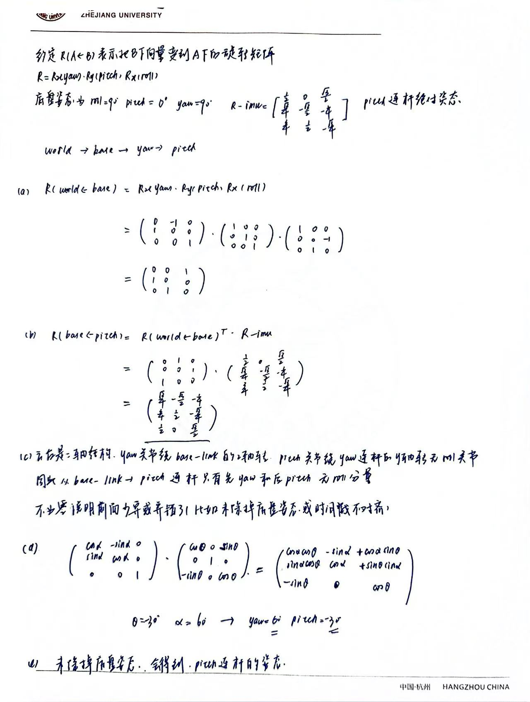

# LocatorNode 任务报告

## 一、反馈

1. 和第一题相比，本题难度显著提升。旋转与坐标变换这部分数学比较好理解，
   掌握得也比较熟练；主要卡在最后把五个节点塞进同一个多线程容器进程，并用
   Foxglove 做可视化，这一块还需要回头再复习文档并多加实践。
2. 目前没有什么特别好的建议。
3. 最大的收获是明确了从光学成像到现实世界具体位姿的解算过程，也进一步理解了
   locator 的设计过程和工作原理。整体压力比第一题大很多。

## 二、理解题

### 1. 为什么分解出的 roll 理论恒为零？不为零说明什么？

`imu_callback` 里先把底盘姿态除掉，得到相对旋转：

```
R_{base←pitch} = R_{world←base}ᵀ · R_imu
```

二轴云台只有 yaw（绕 z）和 pitch（绕 y）两个关节，所以这个相对旋转必然是：

```
R_{base←pitch} = Rz(yaw) · Ry(pitch)
```

乘开：

```
Rz(y)·Ry(p) = ⎡ cos y·cos p   -sin y   cos y·sin p ⎤
              ⎢ sin y·cos p    cos y   sin y·sin p ⎥
              ⎣   -sin p         0        cos p     ⎦
```

`getEulerYPR` 分解时 `roll = atan2(R[2][1], R[2][2])`，而这里 `R[2][1]` 恒为 0，
所以 roll 恒为零；它也正对应 `setRPY(0, pitch, yaw)`（roll 位固定为 0）。

**不为零说明前面某一步错了**，常见来源：

1. 没有先除掉底盘姿态，直接对 `R_imu` 分解；
2. 复合顺序/转置写错（如乘成 `R_imu · R_{world←base}ᵀ`，或该左乘却右乘）；
3. 查询底盘姿态用的时间戳不对（用了最新而非 IMU 采样时刻），把偏差时刻的
   车体姿态减了进去，残留随颠簸变化；
4. 欧拉分解函数或参数顺序用错，导致 roll 与 yaw 串扰。

正确写法下残余 roll 只有 TF 插值的数值量级（约 1e-5 rad）。

**实测**：正常运行期间 locator 无 `unexpected residual roll` 告警，说明残余 roll
在阈值 1e-3 rad 以下。

### 2. 把两个回调查询 TF 的时间改成 rclcpp::Time(0,0,RCL_ROS_TIME)

改动片段（`imu_callback` / `target_callback` 相同处理）：

```cpp
// 改动前：按消息自带的采样时刻查
const rclcpp::Time stamp = msg->header.stamp;
tf_utils::try_lookup_tf(tf_buffer_, frames::WORLD, frames::BASE_LINK, stamp, ...);

// 改动后：查最新一条（0 被 tf2 解释为“最新”）
const rclcpp::Time query_time(0, 0, RCL_ROS_TIME);
tf_utils::try_lookup_tf(tf_buffer_, frames::WORLD, frames::BASE_LINK, query_time, ...);
```

**预测**：不会再丢帧（不报外推），但会因为查询时刻比采样时刻晚几毫秒，
底盘颠簸让姿态对不上，出现几十毫米的系统误差和残余 roll 告警。

**实测**：

| 指标 | 改动前（正确） | 改动后（查最新） |
|---|---|---|
| 平均误差 | 0.030330 mm | 45.466649 mm |
| 最大误差 | 0.165136 mm | 131.360498 mm |
| 配对样本 | 1479（未配对 6/0） | 1445（未配对 0/0） |
| 告警 | 仅启动 2 条 | 运行期 17 条 residual roll + 1 条外推 |

**结论**：改动后不丢帧，所以只看“有没有输出”发现不了；误差升到几十毫米，
并出现 `unexpected residual roll`，说明查询时刻与采样时刻错开，与预测一致。

### 3. 把四个仿真节点从同一容器改成各自独立进程

改动片段（launch）：把装载四个仿真节点 + locator 的

```python
ComposableNodeContainer(
    executable='component_container_mt',
    composable_node_descriptions=[...],
)
```

改为每个节点一个独立的 `Node` 进程：

```python
Node(package='locator_sim', executable='virtual_serial_node',   name='virtual_serial',   parameters=[sim_params, override]),
Node(package='locator_sim', executable='virtual_imu_node',      name='virtual_imu',      parameters=[sim_params, override]),
Node(package='locator_sim', executable='virtual_detector_node', name='virtual_detector', parameters=[sim_params, override]),
Node(package='locator_sim', executable='sim_visualizer_node',   name='sim_visualizer',   parameters=[sim_params, override]),
Node(package='locator',     executable='locator_node',          name='locator',          parameters=[locator_params, override]),
```

**预测**：不报任何错，但各进程各自初始化一份 `SimClock` 的静态 `t0`，
对“仿真从哪一刻开始”不一致，误差升到几十毫米，并伴随零星残余 roll 告警。

**实测**：

| 指标 | 同容器（正确） | 拆成独立进程 |
|---|---|---|
| 平均误差 | 0.030330 mm | 37.629357 mm |
| 最大误差 | 0.165136 mm | 66.555995 mm |
| 配对样本 | 1479 | 1485（未配对 0/0） |
| 告警 | 仅启动 2 条 | 22 条（18 条 residual roll + 启动 4 条） |

**为什么 `t0` 不一致会有影响**：仿真的真值都是“仿真第 t 秒”的函数，
消息里带的却是墙上时钟的绝对时刻 `stamp`，两者靠

```
t = (stamp - t0).seconds()
```

换算。`t0` 是 `sim_clock.hpp` 里**进程内共享的静态变量**，谁先运行谁设。四个节点
放同一进程时共用一份 `t0`，同一个 `stamp` 换算到同一个 `t`，detector 生成观测用的
世界和 serial/imu 发布 TF 用的世界完全一致，链路闭合。拆成多进程后每个进程各有一份
`t0`，同一个 `stamp` 在不同节点里对应到不同的 `t`：观测按 `t_det` 的世界生成，
locator 查到的 TF 却反映 `t_ser`、`t_imu` 的世界，整体错开 `Δt`。底盘绕半径 12 m、
角速度 0.25 rad/s，切向速度约 3 m/s，`Δt = 10 ms` 就带来约 30 mm 的偏差，叠加杠杆臂
与目标自身运动后与实测的 37.6 mm 吻合。**因此四个仿真节点必须在同一进程。**

### 4. 两个订阅用的是哪种回调组？换成 Reentrant 的风险？

两个订阅分别放在两个**独立的 `MutuallyExclusive`（互斥）回调组**里
（`imu_cb_group_`、`target_cb_group_`）。容器用 `component_container_mt`（多线程
执行器），所以两个组之间可以并行；但每个组内部同一回调不会和自身并发。

**换成 `Reentrant` 的风险**：可重入允许**同一个回调同时有多个实例在跑**。
`target_callback` 会调用 `publish_marker`，而 `publish_marker` 里对成员变量
`trail_points_` 做了非只读操作：

```cpp
trail_points_.push_back(p);                        // 可能触发重新分配
if ((int)trail_points_.size() > max_trail_points_)
    trail_points_.erase(trail_points_.begin());    // 删除元素
...
trail.points = trail_points_;                       // 读取
```

若两个 `target_callback` 实例并发执行，就会同时读写同一个 `std::vector`：

- 数据竞争（未定义行为）；
- 一个线程 `push_back` 触发扩容时，另一个线程可能在读旧内存，迭代器/指针失效；
- `erase` 与 `push_back` 并发可能破坏容器结构，导致轨迹错乱甚至崩溃。

`MutuallyExclusive` 保证同一回调串行，正是保护这份共享状态的关键；同时两个组分开，
又让 500 Hz 的 IMU 回调和 60 Hz 的 target 回调互不阻塞。`imu_callback` 只用局部变量，
风险较低，但真正需要注意的就是 target 这条带共享 `trail_points_` 的路径。

## 三、手算题

（手写推导照片，推导过程见下）


